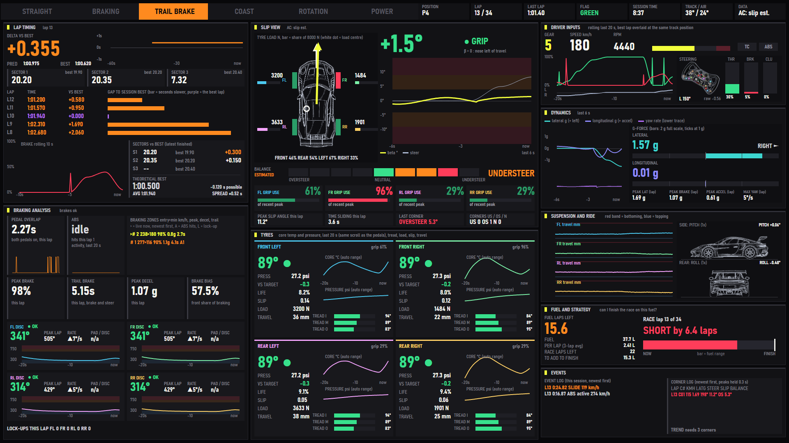
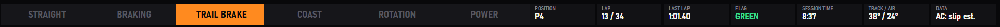
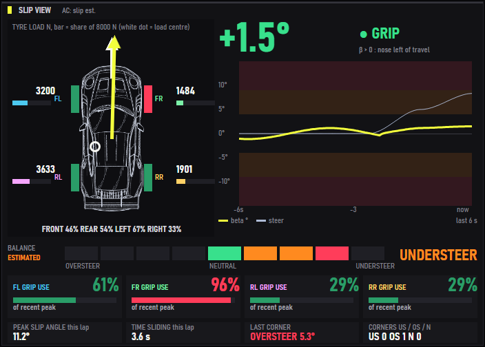
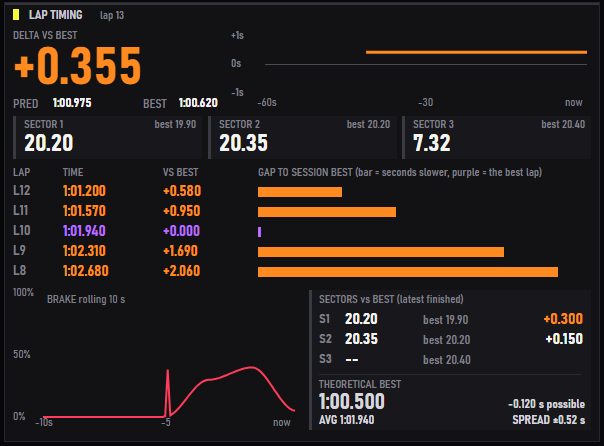
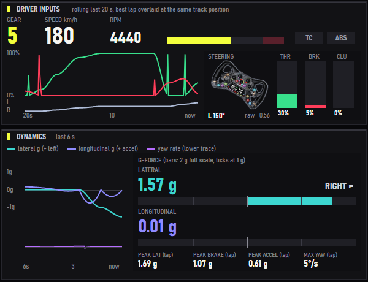
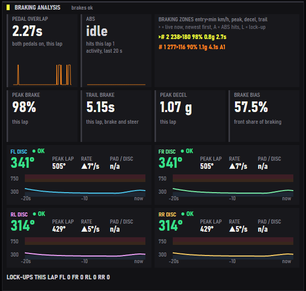
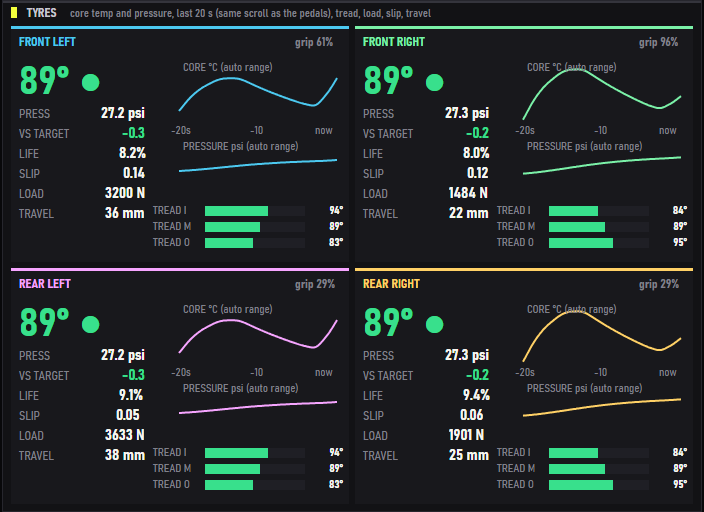
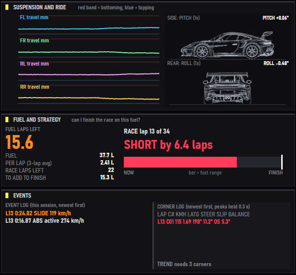

# Telemetry Master Suite

A SimHub dashboard for a second monitor (1920 x 1080) that puts **body slip angle** front and centre and wraps it in the numbers a driver needs to understand a car: tyres, brakes, lap and sector times, fuel, g-forces and corner-by-corner balance. It runs on **SimHub 9.12.9** with **Assetto Corsa Competizione** and **Assetto Corsa**. iRacing is an unfinished side project (the dash says "unsupported" there).



**Release 1.0.0.** It imports and runs in SimHub and has been driven in Assetto Corsa (Nordschleife, Zandvoort). The Assetto Corsa Competizione side is built from SimHub's property catalog and checked offline only. Some signs and units are still inferred, not measured: see [Known limits](#known-limits) and `TO_VERIFY.md`.

## Install

1. Open SimHub, go to Dash Studio and import `dash/out/TelemetryMasterSuite.simhubdash`.
2. Show it the way you show any Dash Studio dashboard (an overlay on the second screen, or SimHub's built-in web server, which is also how `tools/cdp_dash.js` renders it for checking).
3. Drive. The chip at the top right (`AC: slip est.`) tells you where the slip angle comes from.

`dash/out/TMSProbe.simhubdash` is a second, separate dash that prints raw property values, their types and their min/max, so that unverified assumptions can be settled with one screenshot. It is a diagnostic tool, not part of the dash.

## What is visible on the screen

One colour per signal, everywhere: **beta yellow, brake red, throttle green, steering pale blue**; the four tyres are **FL cyan, FR mint, RL pink, RR sand**. Dark graphite panels, signal yellow for headings, Bahnschrift type.

### Top bar



The six tabs show the **driving phase** right now, worked out from pedals, steering and speed: straight, braking, trail braking, coast, rotation and power. The chips on the right show position, lap and last lap (in ACC the gaps ahead and behind), flag colour, session time (elapsed time in practice), track and air temperature, and the data source.

### Slip view: the centre of the dash



- **Beta** (the big number) is the angle between where the car points and where it travels, with a word for the band: *grip* under 4 degrees, *transition* from 4, *slide* from 9. The yellow arrow on the car turns with it; the chart beside it shows beta and steering for the last 6 seconds against the same bands.
- **Tyre load** sits on the top-down car: newtons per wheel with a bar (a share of 8000 N), the front/rear and left/right split underneath, and a white dot for the load centre.
- **Balance** is a nine-segment meter, understeer to oversteer, from how much the front tyres slip compared with the rear while cornering.
- **Grip use** per tyre is its combined slip as a share of the highest it has recently reached (the reference peak rises gradually and halves every 90 seconds, so one kerb strike cannot pin it).
- Under the grip cards: **peak slip angle** and **time sliding** this lap, the **last corner** (understeer, oversteer or neutral, with its size) and the corner count.

### Lap timing



Live delta to your best lap (with a chart that scales to the data), predicted and best lap, **three sector tiles** (purple when equal to your best), the **last five laps** with a gap bar for each (the bar is the time lost to the session best, purple for the best lap itself), a **10-second brake trace**, sector times against your best, the **theoretical best lap** (the sum of your best sectors) and the average and spread of your last five laps (a lap more than 7% slower than the fastest does not count).

### Driver inputs and dynamics



Gear, speed, rpm with a rev bar, TC and ABS lamps, a 20-second trace of throttle, brake and steering, the steering wheel (turning with the real angle) and three pedal bars. The **dynamics** panel has a square graph (lateral g, longitudinal g and yaw rate, last 6 seconds) and a **G-force block**: live lateral and longitudinal g with direction words and centred bars (2 g full scale), plus this lap's peaks for lateral g, braking, acceleration and yaw rate.

### Braking analysis



Pedal overlap, ABS activity, a **braking-zone roadbook** (entry and minimum speed, peak pedal, deceleration, trail-braking time, ABS hits, lock-ups), peak brake, trail braking, peak deceleration and brake bias, and for each of the four discs the temperature, the peak this lap, the heating rate and a 20-second trace against the working window. Lock-ups are counted per wheel for the lap.

### Tyres



One card per tyre: core temperature (with a trend arrow), pressure against your target, life, slip, load and suspension travel, three-point tread temperatures, and 20-second traces of core temperature and pressure.

### Suspension, fuel, events and corners



- **Suspension and ride**: four damper-travel traces with bottoming (red) and topping (blue) bands, and a side view and rear view of the car that tilt with **pitch and roll at their true angle (1x)**, with the numbers next to them. An early version drew them at 10x and 6x, which made a small bump look like take-off.
- **Fuel and strategy**: fuel left in laps, litres per lap (your own average), laps left in the race, litres to add, and one bar that says whether the fuel reaches the finish.
- **Event log**: slides, lock-ups, ABS and TC activations, newest first, each with lap, lap time and speed.
- **Corner log**: one row per corner (the same test the balance meter uses: 30 km/h and 0.3 g, lasting at least a second): lap and corner number, slowest speed, peak lateral g, peak steering angle, peak slip angle and the understeer / oversteer verdict, coloured by verdict. The **trend** line is the average balance of the last eight corners. Peaks are the third highest sample, so a kerb strike cannot set them.

## What works in which game

| | ACC | AC |
|---|---|---|
| Slip angle | from SimHub's body-frame velocity | **estimated** from world velocity and heading; it learns the heading convention on straights, so give it a few seconds |
| Balance and grip use | per-tyre slip angles (named in SimHub's catalog, not yet seen live) | from AC's `WheelSlip` (see limits) |
| Sectors | the game's when it gives them | timed by the dash from the sector index (AC lacks sectors 2 and 3) |
| Delta to best | the game's | SimHub's PersistantTracker delta |
| Gaps | ahead and behind in the top bar | not available, the bar shows lap and last lap instead |
| Fuel per lap | SimHub's computed value when it has one | measured by the dash (SimHub's value read 0 in AC) |
| Oil and water temperature | yes | AC reports 0, shown as n/a |

## Known limits

- **AC balance numbers are not real degrees.** AC has no slip angle; the balance meter, the grip use and the last-corner card use `WheelSlip`, which is unitless, multiplied by 180/pi and printed with a degree sign. Which end slides more is right; the size is not in degrees, and the "neutral" band is very tight in those units. The slip angle itself (the big number) is a real angle.
- Corners as light as 0.3 g (a kink at speed) are logged and get a verdict.
- The direction words in the G-force block assume SimHub's lateral g is positive to the left (inferred from the first probe).
- iRacing is not supported (yet).

### Tests

`npm test` runs the physics tests, the adapter tests, the dash tests (sectors, lap history, G peaks, slip statistics, corner log, ...), and a validator that checks the generated dash against the file format of reference dashboards, checks that every text fits its box, parses every formula as ES5, and **runs all formulas on simulated ACC and AC telemetry** (394 formulas across 681 items).

### Checking a dash in SimHub's real client

With SimHub running and the dash imported, `node tools/cdp_dash.js TelemetryMasterSuite 12` renders it headlessly in SimHub's own web client, prints console errors and uncaught exceptions, compares the number of rendered items with the file and saves a screenshot. SimHub caches a dash definition by file modified time, which once made re-imports look unchanged and blank; the packager now stamps every file with the build time (see `TO_VERIFY.md` section S).

### Build

```
npm install
node build/build_dash.js
node build/build_probe.js
python build/package.py
npm test
```

Python needs Pillow. Pictures like the ones above: `node build/preview.js ac 40`, then open `dash/out/preview_ac.html` (`acc` for Assetto Corsa Competizione, a third argument `practice` for a practice session).

## Repository layout

| Path | What it is |
|---|---|
| `dash/out/*.simhubdash` | the two finished packages: the dash and the probe |
| `dash/js/tms_dash.js` | the binding library shipped inside the dash |
| `dash/assets/` | images embedded in the dash |
| `lib/` | physics and game adapters, ES5, no SimHub dependency |
| `build/` | generator, probe generator, packager, preview renderer, layout geometry |
| `tools/` | the real-client check, image helpers |
| `test/` | unit tests and the build validator |
| `docs/images/` | the pictures in this file |
| `mock/` | the first HTML mock the layout started from (out of date: the builder now changes the layout itself) and a telemetry simulator |
| `template_extracted/` | an empty 1920 x 1080 dash exported from SimHub, used as the packaging template |
| `TO_VERIFY.md`, `property-map.md` | what was measured and what was only inferred, and the SimHub property names the dash reads |
| `docs/notes/` | the design notes written while the dash was built (historical: the layout is now generated by `build/build_dash.js`) |

Kept local on purpose: third-party reference dashboards, read to learn the file format and which property names exist, never copied (`friend_extracted/`, `ref_extracted/`; the three schema tests skip without them), the raw source images for the car and wheel cut-outs, and one-off patch scripts.

## Release notes

See `CHANGELOG.md`.
