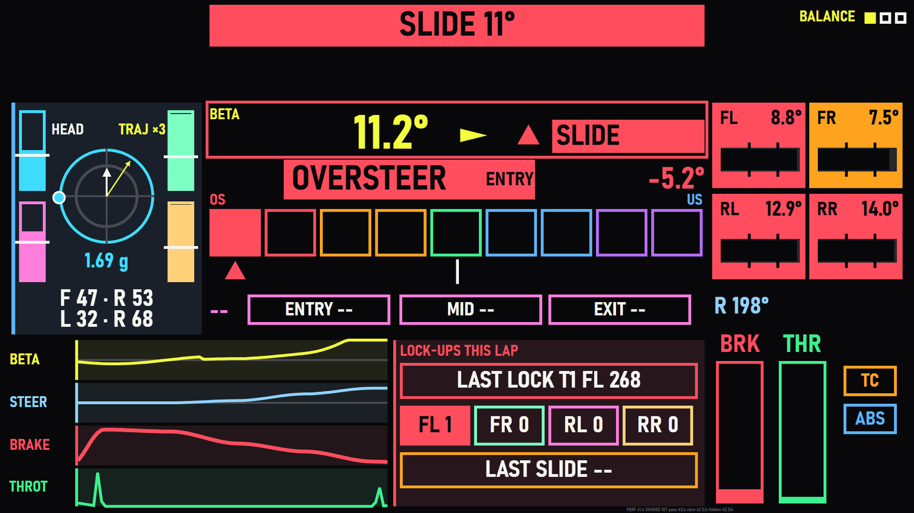
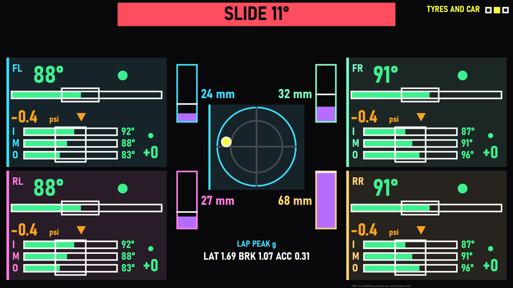
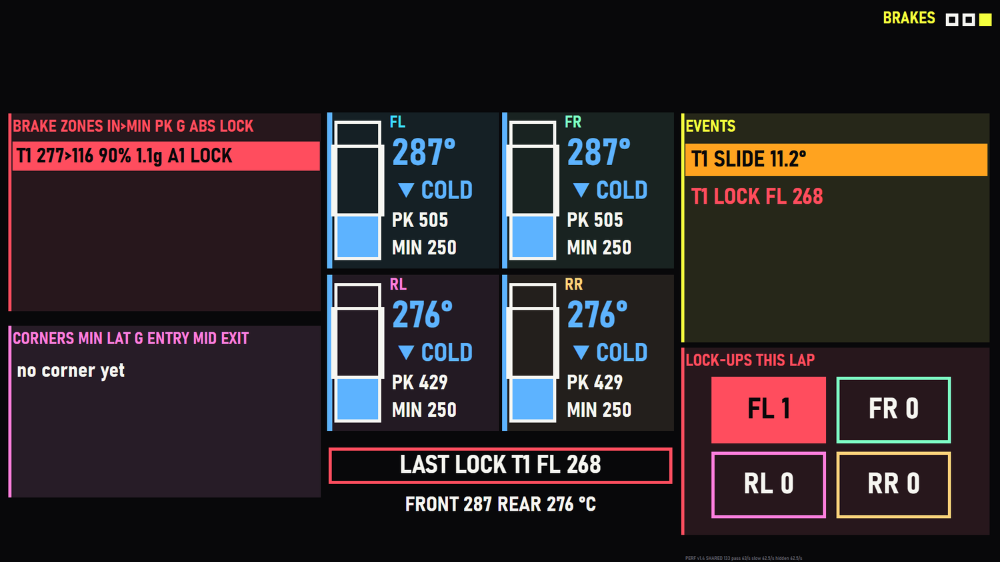
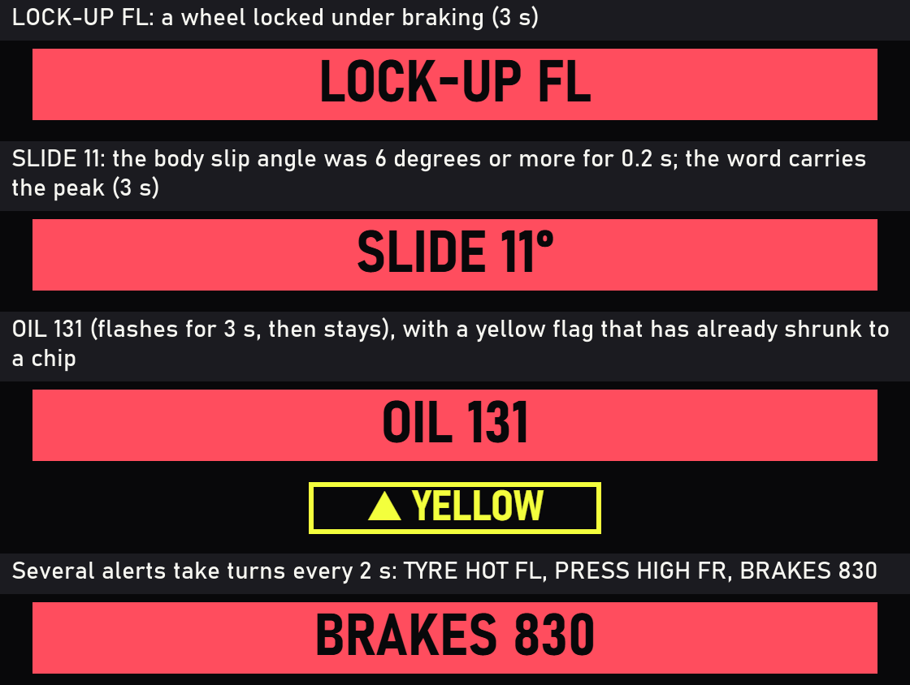
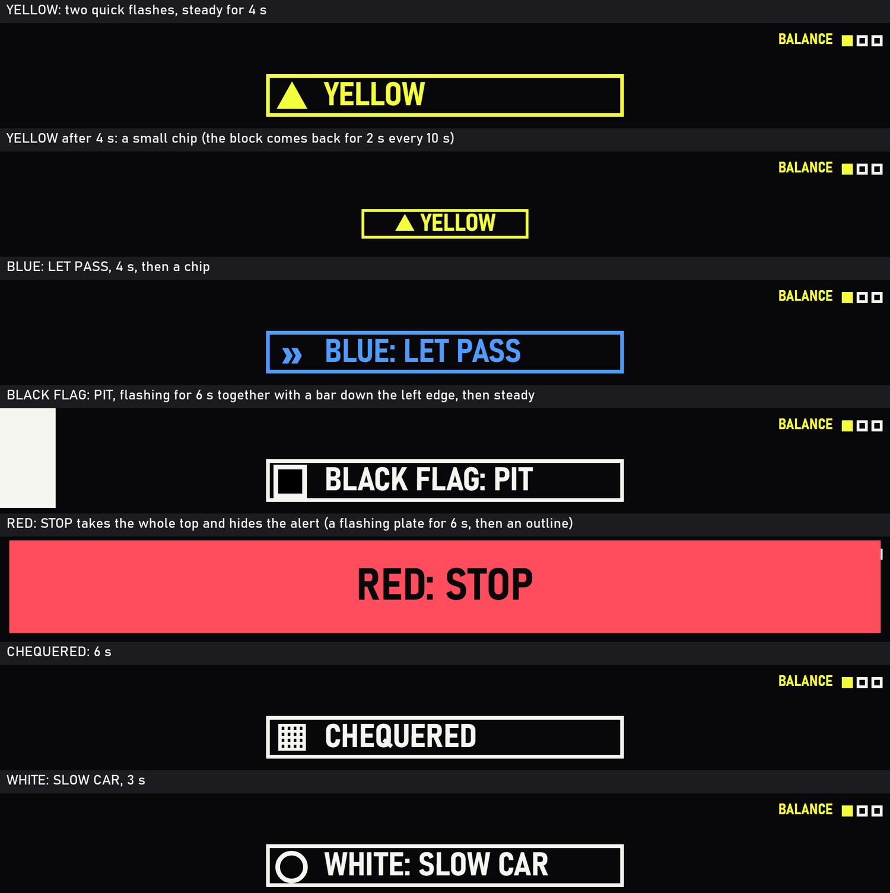
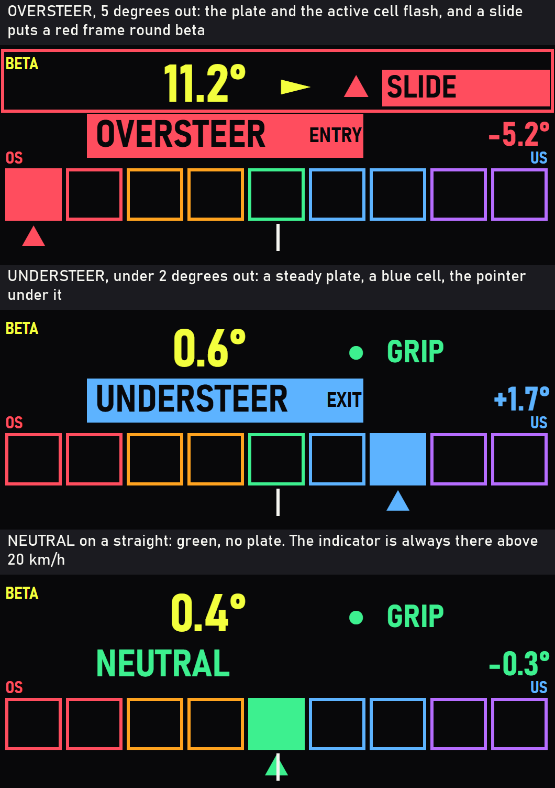
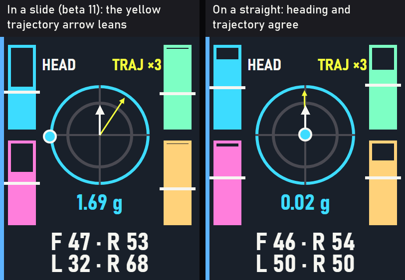
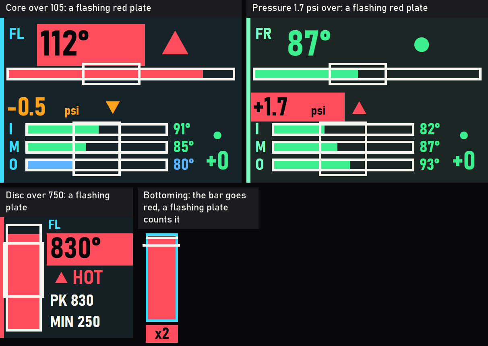

# Telemetry Master Suite

A SimHub dashboard for a second monitor (1920 x 1080) that puts **body slip angle** front and centre and wraps it in the numbers a driver needs to understand a car: tyres, brakes, lap and sector times, fuel, g-forces and corner-by-corner balance. It runs on **SimHub 9.12.9** with **Assetto Corsa Competizione** and **Assetto Corsa**. iRacing is an unfinished side project (the dash says "unsupported" there).



**Release V1.2** ships four new dash versions beside the unchanged 1.0.0 dash: 1.1 (light on SimHub's formula engine), 1.2 (three pages), 1.3 (a glance page) and **1.4, the current dash, `TelemetryMasterSuite_v1_4`**: a side panel for detailed telemetry on three pages with colour, flashing pop-ups, a g-meter with heading and trajectory arrows, and an always-live balance. Import `dash/out/TelemetryMasterSuite_v1_4.simhubdash`. Version 1.4 was drawn for a bright-sun glance and has not been driven yet: see `TO_VERIFY.md` section AA.

**Release 1.0.0.** It imports and runs in SimHub and has been driven in Assetto Corsa (Nordschleife, Zandvoort). The Assetto Corsa Competizione side is built from SimHub's property catalog and checked offline only. Some signs and units are still inferred, not measured: see [Known limits](#known-limits) and `TO_VERIFY.md`.

**Version 1.1** (`TelemetryMasterSuite_v1_1`, released in V1.2) has the same panels and shows the same values, but is built to be light on SimHub's formula engine, which is where the lag of 1.0.0 most likely came from. It is a separate dash: the 1.0.0 package is kept unchanged next to it so the two can be compared.

**Version 1.4** (`TelemetryMasterSuite_v1_4`, released in V1.2) is a **side panel for detailed telemetry** next to a main dash and a DDU that already show speed, gear, laps, fuel, flags and tyres. Three pages: **Balance** (understeer / oversteer, beta, load on each tyre, the pedals, steering and beta over 8 s), **Tyres and car** and **Brakes**. Pop-ups in two lanes over every page show lock-ups, slides, overheating and **flags**. It was designed from three reviews (a simulated driver with the two other dashes in front of them, a race engineer, a graphic designer): [docs/notes/DESIGN_1_4.md](docs/notes/DESIGN_1_4.md).

**Version 1.3** (`TelemetryMasterSuite_v1_3`, released in V1.2) put a **glance page** in front: big white and yellow shapes you can read in half a second (shift bar, gear, speed, position and gaps, delta, alerts), with the panels of 1.2 on three more pages behind it and a compact version of the glance on top of each. It follows the review in [docs/notes/DRIVER_REVIEW.md](docs/notes/DRIVER_REVIEW.md) (a simulated driver, an 11 inch screen 75 cm away in bright sun). See [Pages](#pages).

**Version 1.2** (`TelemetryMasterSuite_v1_2`, released in V1.2) is 1.1 on **three pages**, switched with a wheel button. SimHub does not evaluate anything on a page that is not shown, so a panel on another page costs nothing. Same panels, same values; each page has fewer of them. See [Pages](#pages) and [Performance](#performance).

## Install

1. Open SimHub, go to Dash Studio and import `dash/out/TelemetryMasterSuite_v1_4.simhubdash` (the 1.3, 1.2, 1.1 and 1.0.0 dashes, `dash/out/TelemetryMasterSuite_v1_3.simhubdash`, `dash/out/TelemetryMasterSuite_v1_2.simhubdash`, `dash/out/TelemetryMasterSuite_v1_1.simhubdash` and `dash/out/TelemetryMasterSuite.simhubdash`, can stay installed beside it).
2. Show it the way you show any Dash Studio dashboard (an overlay on the second screen, or SimHub's built-in web server, which is also how `tools/cdp_dash.js` renders it for checking).
3. In SimHub's **Controls and events**, map a wheel button (or a dial) to **Show next dash screen** and another to **Show previous dash screen**. That flips the pages.
4. Drive. In AC the slip angle is estimated: the balance reads `EST` beside the verdict.

`dash/out/TMSProbe.simhubdash` is a second, separate dash that prints raw property values, their types and their min/max, so that unverified assumptions can be settled with one screenshot. It is a diagnostic tool, not part of the dash.

## Pages

`TelemetryMasterSuite_v1_4` is a **side panel**. It shows what the main dash and the DDU do not (balance, slip angle, tyre and brake detail, suspension, logs) and nothing they already show (speed, gear, rpm, delta, laps, fuel, position). Three pages, switched with the wheel's next / previous screen actions; the page name and three squares (the current one filled) are at the top right. Every live number is 40 px or bigger, every label 32 px or bigger, every line 6 px or thicker (see [docs/notes/DESIGN_1_4.md](docs/notes/DESIGN_1_4.md)).

| Page | What is on it |
|---|---|
| 1 **Balance** | a load bar on each tyre (against that tyre's own peak, a tick at its average, front-rear and left-right split in per cent) with a **g-meter** between them (rings at 1 g and 1.5 g, a dot where the car's g is, the total g under it, and the arrows below); **beta** as a 100 px number that is always there, with an arrow for the way the tail swings from 2 degrees, and the **heading and trajectory** arrows inside the g-meter (both start at its centre: the white one is where the nose points, the yellow one where the car is going; the angle between them is beta, drawn three times as big); the grip word (GRIP, TRANSITION, SLIDE) with a glyph; the **balance verdict** (UNDERSTEER, OVERSTEER, NEUTRAL, or SPIN) with its size in degrees of front minus rear slip and the driving phase, always live from 20 km/h (on a straight it reads neutral), nine cells with the active one solid and a pointer under it; the last corner's verdict per phase (entry, mid, exit); four traces over 8 s in the left half of the lower area (beta, steering, brake, throttle, 6 to 8 px) and, in the right half, the **last lock-up** (a flashing plate for 3 s, with its corner, wheel and speed), the lock-ups this lap per wheel and the **last slide** (corner and peak angle); a slip-angle tile per tyre; brake and throttle bars; steering; TC and ABS squares that flash while active |
| 2 **Tyres and car** | four tyre cards (core temperature at 88 px with a bar and its 80 to 95 window, hot-pressure delta against the target with an arrow, inner / middle / outer bars with their window, a spread verdict after two laps); four suspension bars with the lap's peak and the travel in mm; a g-g diagram with a dot and the lap's peak g |
| 3 **Brakes** | the last braking zones and corners as readable rows, four disc cards (thermometer, COLD / OK / HOT, lap peak, lap minimum), front and rear mean, the last lock-up, the event list (lock-ups, slides, bottoming, a TC held for over a second) and the lock-ups this lap per wheel |

**Pop-ups** are drawn over every page, in two fixed lanes:
- **Alert lane (top middle):** one word with its value on a solid block in the colour of its kind (red for a lock-up, slide, oil, water, brakes or a hot tyre; amber for fuel or a high pressure; blue for a brake-bias change). Momentary: a lock-up with its wheel (3 s), a slide (the body slip angle at 6 degrees or more for 200 ms, the word carries the peak, for example `SLIDE 11°`, 3 s), a brake-bias change (2 s). Persistent, rotating every 2 s when there are several: oil over 130 C and water over 105 C (each for 3 s, cleared below 125 and 100), fuel for two laps or less when it cannot finish, brakes over 750 C for 2 s (cleared below 650), a tyre core over 105 C for 1.5 s (`TYRE HOT RL`), a hot pressure over 0.7 psi above the target for 3 s (`PRESS HIGH RR`). A new persistent alert flashes at 2 Hz for 3 s, then stays; the momentary ones never flash.
- **Flag lane (under it):** an outlined block in the flag's colour with the flag's own shape (a triangle for yellow, a double chevron for blue, a chequered cell, a hollow circle for white, a solid cell for black), because in bright sun white and yellow are the same brightness. Yellow: two quick flashes, steady for 4 s, then a small chip, and the block comes back for 2 s every 10 s while it is out. Blue: 4 s, then a chip. Green: 1.5 s after a yellow or red clears. Black: flashes for 6 s together with a bar down the left edge, then stays with a thin edge strip. Chequered: 6 s. White: 3 s. **Red** takes the whole top (a flashing plate for 6 s, then an outline) and hides the alert.
- With the game **not running** SimHub keeps the last values; the pop-ups stay away then (`DataCorePlugin.GameRunning`).

**Colour** tells the eye which cluster and which signal it is on. One colour per signal: beta yellow, steering pale blue, brake red, throttle green, TC amber, ABS blue. One per tyre (FL cyan, FR mint, RL pink, RR sand), worn by its load bar, slip tile, tyre card, suspension frame, disc card and lock-up tile. One per cluster, as a panel with a hint of its colour and a bar down its left edge: load blue, last corner and corner list pink, brake zones and lock-ups red, events yellow, g forces cyan, suspension violet. And state colours on every temperature, pressure and balance reading: blue cold or understeer, green in the window or neutral, amber warm, red hot or oversteer (the nine balance cells run red, orange, green, blue, violet). In bright sun every colour except white and yellow loses most of its contrast, so colour is never the only cue: each state is also a plate (an inverted block with dark ink), a glyph, a position or a flash.

**Flashing** (about 3 Hz) marks what needs you now: a balance 2 degrees or more out (the verdict plate and the active cell), a slide (the grip plate and a red frame round the whole hero), a slip angle of 8 degrees or more, a tyre core over 105 C, a hot pressure over 1.2 psi above the target, a disc over 750 C, a bottoming, a fresh lock-up (that wheel's tile and the last-lock plate for 3 s), the newest event (2 s), TC and ABS (4 Hz) and a new alert (2 Hz for 3 s). With the game not running SimHub holds the last frame, and then everything is steady and the pop-ups stay away. In a spin (20 degrees of body slip or more) the verdict says SPIN on a flashing red plate and the cells go out; under 20 km/h it says `--`.

**Not on it:** a shift bar, speed, gear, position, gaps, delta, laps, fuel strategy, session time. SimHub cannot change page by itself (a screen's enable expression is only evaluated when you switch) and has no button that jumps to page 1, so there is no auto-return and no home button; with three pages any page is at most one press away.

**Thresholds are defaults** (`TMS_GL` in `dash/js/tms_dash.js`), none measured on a real car. In AC the slip angle is estimated (the balance carries `EST`) and the game gives no full suspension stroke: the bars show the travel inside the range seen so far, and no bottoming is counted (ACC gives the stroke and does count it). The counters that run over a lap (braking zones, corners, events, load peaks, the lap's peaks) keep running on the pages you are not looking at, because every page carries the shared per-frame step (if the `PERF` line ever says `PRIVATE`, SimHub is not sharing the script variables and they pause on a page you are not looking at). The traces on a page that is not shown get no new points; when you come back they continue from where they stopped.

### The three pages

The pictures in this file are drawn from a simulated lap (`python tools/readme_pictures.py`): the numbers are made up, the layout, colours, wording and flashing states are what the dash draws.

**Page 1, Balance** (here in an oversteer slide). This is the page to leave on.


- **Left:** a load bar per tyre in the tyre's colour (against that tyre's own peak, a white tick at its average), the **g-meter** between them with the heading and trajectory arrows, the total g under it, and the front-rear and left-right weight split.
- **Middle:** **beta** in yellow with an arrow for the way the tail swings, the grip word (GRIP, TRANSITION, SLIDE), the **balance verdict** with the phase and its size in degrees of front minus rear slip, nine cells (oversteer red and orange on the left, neutral green, understeer blue and violet on the right) with one solid and a pointer under it, and the last corner's verdict for entry, mid and exit.
- **Right:** a slip-angle tile per tyre, steering, the brake and throttle bars, and the TC (amber) and ABS (blue) squares.
- **Bottom:** the last 8 s of beta, steering, brake and throttle, and (red) the last lock-up, the lock-ups this lap per wheel and the last slide.

**Page 2, Tyres and car** (mid corner). Four tyre cards in the tyre's colour: core temperature with its 80 to 95 window, pressure against the target, inner, middle and outer temperature with their window, and a tread spread verdict after two laps. Between them four suspension bars (violet, amber from 90% and red from 95% of the stroke in ACC) with the lap's peak, and a g-g diagram with the lap's peak g under it.



**Page 3, Brakes** (after the lock-up and the slide): the braking zones and the corners, four disc thermometers (blue cold, green in the window, amber warm, red hot) with the lap's peak and minimum, the last lock-up, the event list and the lock-ups this lap per wheel.



### Examples

**Alerts.** One word with its value, top middle, on a block in the colour of its kind. A lock-up and a slide show for 3 s, persistent alerts (oil, water, fuel, brakes, a hot tyre, a high pressure) take turns every 2 s and flash for 3 s when they are new.



**Flags.** The lane under the alert: a block in the flag's colour with its own shape (a triangle, a double chevron, a black square, a chequered cell, a ring), because white and yellow look the same brightness in bright sun. Red takes the whole top; black also lights a bar down the left edge.



**The balance indicator is always there** (above 20 km/h), not only when the car is doing something. Front minus rear slip angle in degrees: under 0.7 it reads NEUTRAL in green; beyond that a steady plate (blue for understeer, red for oversteer), flashing from 2 degrees. In a spin (20 degrees of beta or more) it says SPIN.



**Heading and trajectory.** Both arrows start at the centre of the g-meter. The white one is where the nose points and never moves. The yellow one is where the car is going, turned by three times beta, so the angle between them is the slip angle. On a straight they agree; in a slide the yellow arrow leans away. The dot is where the car's g is.



**Critical states flash a plate.** A tyre core over 105 C, a pressure more than 1.2 psi over the target, a disc over 750 C and a bottoming (ACC, which gives the full stroke) each flash a red plate (about 3 Hz) on top of their colour.



## What is visible on the screen

*The sections below describe the panels of 1.0.0 to 1.3 (the pictures are 1.0.0). 1.4 is drawn differently: see [Pages](#pages).*


One colour per signal, everywhere: **beta yellow, brake red, throttle green, steering pale blue**; the four tyres are **FL cyan, FR mint, RL pink, RR sand**. Dark graphite panels, signal yellow for headings, Bahnschrift type.

### Top bar


The six tabs show the **driving phase** right now, worked out from pedals, steering and speed: straight, braking, trail braking, coast, rotation and power. The chips on the right show position, lap and last lap (in ACC the gaps ahead and behind), flag colour, session time (elapsed time in practice), track and air temperature, and the data source.

### Slip view: the centre of the dash


- **Beta** (the big number) is the angle between where the car points and where it travels, with a word for the band: *grip* under 4 degrees, *transition* from 4, *slide* from 9. The yellow arrow on the car turns with it; the chart beside it shows beta and steering for the last 6 seconds against the same bands.
- **Tyre load** sits on the top-down car: newtons per wheel with a bar (a share of 8000 N), the front/rear and left/right split underneath, and a white dot for the load centre.
- **Balance** is a nine-segment meter, understeer to oversteer, from how much the front tyres slip compared with the rear while cornering.
- **Grip use** per tyre is its combined slip as a share of the highest it has recently reached (the reference peak rises gradually and halves every 90 seconds, so one kerb strike cannot pin it).
- Under the grip cards: **peak slip angle** and **time sliding** this lap, the **last corner** (understeer, oversteer or neutral, with its size) and the corner count.

### Lap timing


Live delta to your best lap (with a chart that scales to the data), predicted and best lap, **three sector tiles** (purple when equal to your best), the **last five laps** with a gap bar for each (the bar is the time lost to the session best, purple for the best lap itself), a **10-second brake trace**, sector times against your best, the **theoretical best lap** (the sum of your best sectors) and the average and spread of your last five laps (a lap more than 7% slower than the fastest does not count).

### Driver inputs and dynamics


Gear, speed, rpm with a rev bar, TC and ABS lamps, a 20-second trace of throttle, brake and steering, the steering wheel (turning with the real angle) and three pedal bars. The **dynamics** panel has a square graph (lateral g, longitudinal g and yaw rate, last 6 seconds) and a **G-force block**: live lateral and longitudinal g with direction words and centred bars (2 g full scale), plus this lap's peaks for lateral g, braking, acceleration and yaw rate.

### Braking analysis


Pedal overlap, ABS activity, a **braking-zone roadbook** (entry and minimum speed, peak pedal, deceleration, trail-braking time, ABS hits, lock-ups), peak brake, trail braking, peak deceleration and brake bias, and for each of the four discs the temperature, the peak this lap, the heating rate and a 20-second trace against the working window. Lock-ups are counted per wheel for the lap.

### Tyres


One card per tyre: core temperature (with a trend arrow), pressure against your target, life, slip, load and suspension travel, three-point tread temperatures, and 20-second traces of core temperature and pressure.

### Suspension, fuel, events and corners


- **Suspension and ride**: four damper-travel traces with bottoming (red) and topping (blue) bands, and a side view and rear view of the car that tilt with **pitch and roll at their true angle (1x)**, with the numbers next to them. An early version drew them at 10x and 6x, which made a small bump look like take-off.
- **Fuel and strategy**: fuel left in laps, litres per lap (your own average), laps left in the race, litres to add, and one bar that says whether the fuel reaches the finish.
- **Event log**: slides, lock-ups, ABS and TC activations, newest first, each with lap, lap time and speed.
- **Corner log**: one row per corner (the same test the balance meter uses: 30 km/h and 0.3 g, lasting at least a second): lap and corner number, slowest speed, peak lateral g, peak steering angle, peak slip angle and the understeer / oversteer verdict, coloured by verdict. The **trend** line is the average balance of the last eight corners. Peaks are the third highest sample, so a kerb strike cannot set them.

## Performance

**Why 1.0.0 lagged (most likely).** SimHub does not run dash formulas in the overlay or the browser: its own server evaluates every formula with an interpreter (Jint) and sends only the results. Every formula costs about 25 microseconds before it does anything, and in 1.0.0 every row of the corner log, event log and braking zones, and every colour that depends on them, ran its own copy of the detector it reads. In SimHub's own Jint engine with simulated telemetry one pass over the 394 formulas took about 57 ms (ACC) and 90 ms (AC); a frame at 60 Hz is 16.7 ms. How many passes per second SimHub really makes, and whether this is what you feel as lag, is not proven: see `docs/notes/PERFORMANCE.md`.

**What 1.1 changes** (the same panels and exactly the same values; an identity test checks every formula against the 1.0.0 library):

- the detectors keep one shared state and each runs at most once per data frame instead of once per row, and the text of a row is rebuilt only when what it shows changed;
- values that move slowly are refreshed every 100 to 2000 ms instead of every frame (charts keep their own rate, which is their time axis);
- if SimHub turns out not to share the script variables between formulas, the library notices and falls back to the 1.0.0 behaviour; `TMS_SHARE = false` in `dash/js/tms_dash.js` forces it.

**What 1.2 changes:** the panels are split over three pages (above) and every counter that must run all the time moved into the shared per-frame step, which every page carries (page 1 on the slip arrow, pages 2 and 3 on a tiny invisible item). In SimHub 9.12.9 (no game running) the formulas of a screen that is not shown, and of children of a layer that is hidden, did not run at all; the screen switch worked from the same action a wheel button triggers.

Measured on an idle machine in SimHub's own Jint engine with simulated ACC telemetry, one pass over all formulas takes about **33 ms** in 1.0.0, **13 ms** in 1.1, and **2.6 to 4.7 ms** for the formulas of one page in 1.2 (modelled formula time per second at 60 Hz: 1108, 101 and 31 to 61 ms; `docs/notes/PERFORMANCE.md`). The figures quoted below for 1.1 (24 ms against 57 and 90) were taken on a busy machine: the ratio is the same, the milliseconds are about twice too high.

Measured in the same engine for 1.1: one pass takes about **24 ms** (ACC and AC) instead of 57 and 90 ms. Read off the self-check line below in SimHub 9.12.9 (no game running), SimHub **does** share the script variables between formulas, **does** skip the evaluation between refreshes (a formula set to once a second ran 0.9 times a second while an unthrottled one ran 10 times a second) and does **not** evaluate the formulas of hidden items. With the refresh intervals honoured, the CPU time spent on formulas drops to about a tenth. A full pass of 24 ms is still more than one 60 Hz frame; with pages, a page shows only about half or less of it (see `docs/notes/PLAN_SLIM_PAGED.md`). A slimmer variant (merged rows, fixed chart ranges) is possible on top; it changes what the dash shows, so it is your call.

**The self-check line.** The dim line at the bottom right edge reads like `PERF  v1.2  SHARED 312  pass 58/s  slow 1.0/s  hidden 0.0/s`. `SHARED n` means the script variables are shared between the formulas (`PRIVATE`: they are not, and 1.1 then behaves like 1.0.0 apart from the refresh intervals). `pass` is how often SimHub runs a formula that is never throttled, `slow` how often it runs one set to once a second (about 1/s: the intervals really skip the evaluation; about as high as `pass`: SimHub still evaluates every frame), and `hidden` how often it runs a formula on a hidden item (0: hidden items cost nothing). With no game running SimHub showed `SHARED 113 to 118`, `pass 10/s`, `slow 0.9/s` and `hidden 0.0/s`; while you drive, `pass` shows how often SimHub really runs the dash.

## What works in which game

| | ACC | AC |
|---|---|---|
| Slip angle | from SimHub's body-frame velocity | **estimated** from world velocity and heading; it learns the heading convention on straights, so give it a few seconds |
| Balance and grip use | per-tyre slip angles (named in SimHub's catalog, not yet seen live) | from AC's `WheelSlip` (see limits) |
| Sectors | the game's when it gives them | timed by the dash from the sector index (AC lacks sectors 2 and 3) |
| Delta to best | the game's | SimHub's PersistantTracker delta |
| Gaps | ahead and behind in the top bar | not available, the bar shows lap and last lap instead |
| Fuel per lap | SimHub's computed value when it has one | measured by the dash (SimHub's value read 0 in AC) |
| Oil and water temperature | yes | AC reports 0, shown as n/a |

## Known limits

- **AC balance numbers are not real degrees.** AC has no slip angle; the balance meter, the grip use and the last-corner card use `WheelSlip`, which is unitless, multiplied by 180/pi and printed with a degree sign. Which end slides more is right; the size is not in degrees, and the "neutral" band is very tight in those units. The slip angle itself (the big number) is a real angle.
- Corners as light as 0.3 g (a kink at speed) are logged and get a verdict.
- The direction words in the G-force block assume SimHub's lateral g is positive to the left (inferred from the first probe).
- iRacing is not supported (yet).

### Tests

`npm test` runs the physics tests, the adapter tests, the dash tests (sectors, lap history, G peaks, slip statistics, corner log, ...), and a validator that checks the generated dash against the file format of reference dashboards, checks that every text fits its box, parses every formula as ES5, and **runs all formulas on simulated ACC and AC telemetry** (583 formulas across 788 items on three pages). An identity test checks that the formulas shared with the frozen 1.0.0 library give exactly its output, and that every formula gives the same output however SimHub hosts the library (shuffled order, several JavaScript engines, the kill switch) over a simulated lap (about 30 s). A glance test steps the pop-up, balance, load, suspension and event logic with a mock clock (22 tests). A paging test simulates a page that is hidden for a few seconds and checks that every panel then shows what it would have shown (about 40 s).

### Checking a dash in SimHub's real client

With SimHub running and the dash imported, `node tools/cdp_dash.js TelemetryMasterSuite_v1_4 12` (add `--page 2` to switch to page 2 first) renders it headlessly in SimHub's own web client, prints console errors and uncaught exceptions, compares the number of rendered items with the file and saves a screenshot. SimHub caches a dash definition by file modified time, which once made re-imports look unchanged and blank; the packager now stamps every file with the build time (see `TO_VERIFY.md` section S).

### Build

```
npm install
node build/build_dash.js
node build/build_probe.js
python build/package.py
npm test
```

Python needs Pillow. The pictures of version 1.4 in this file: `python tools/readme_pictures.py` (it runs `build/preview.js` for each moment and scenario, takes the screenshots with headless Edge and cuts and labels them). One picture by hand: `node build/preview.js ac 40`, then open `dash/out/preview_ac.html` (`acc` for Assetto Corsa Competizione, a third argument `practice` for a practice session).

## Repository layout

| Path | What it is |
|---|---|
| `dash/out/*.simhubdash` | the finished packages: the current dash (`TelemetryMasterSuite_v1_4`), the 1.3, 1.2 and 1.1 dashes, the unchanged 1.0.0 dash and the probe |
| `dash/js/tms_dash.js` | the binding library shipped inside the dash |
| `dash/assets/` | images embedded in the dash |
| `lib/` | physics and game adapters, ES5, no SimHub dependency |
| `build/` | generator, probe generator, packager, preview renderer, layout geometry |
| `tools/` | the real-client check, image helpers |
| `test/` | unit tests and the build validator |
| `docs/images/` | the pictures in this file |
| `mock/` | the first HTML mock the layout started from (out of date: the builder now changes the layout itself) and a telemetry simulator |
| `template_extracted/` | an empty 1920 x 1080 dash exported from SimHub, used as the packaging template |
| `TO_VERIFY.md`, `property-map.md` | what was measured and what was only inferred, and the SimHub property names the dash reads |
| `docs/notes/` | the design notes written while the dash was built (historical: the layout is now generated by `build/build_dash.js`) |

Kept local on purpose: third-party reference dashboards, read to learn the file format and which property names exist, never copied (`friend_extracted/`, `ref_extracted/`; the three schema tests skip without them), the raw source images for the car and wheel cut-outs, and one-off patch scripts.

## Release notes

See `CHANGELOG.md`.
